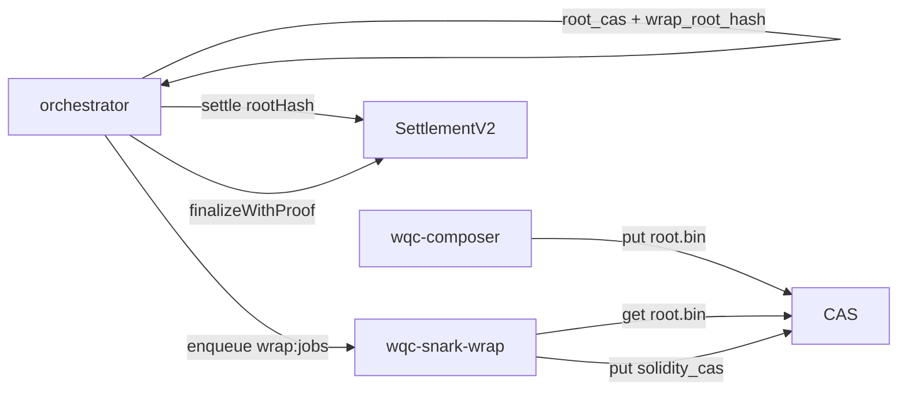

# SNARK Wrap of WQC Root STARKs for On-Chain Settlement

**A Formal Protocol Specification for the World Quantum Computer (WQC) Succinct Validity Layer**

- **Tier:** A (canonical protocol spec)
- **Related:** [`zk-STARK.md`](zk-STARK.md) (root STARK $\pi_{\text{Root}}$), [`architecture.md`](architecture.md), [`architecture-current.md`](architecture-current.md), [`economics.md`](economics.md), working ledger [`wqc-contracts` `docs/on-chain_settlement_scope.md`](https://github.com/world-qc/wqc-contracts/blob/main/docs/on-chain_settlement_scope.md) (public↔historical gate glossary)

---

## Abstract

WQC workers and aggregators produce a recursively aggregated STARK $\pi_{\text{Root}}$ whose
verification cost is feasible off-chain but not inside L2 block-gas limits at current
artifact sizes. This document specifies the **SNARK wrap** layer that reduces
$\pi_{\text{Root}}$ to a succinct argument $\pi_{\text{snark}}$ suitable for on-chain
settlement. The wrap is the artifact the L2 verifier checks on the **validity settlement
path**. An **optimistic settlement** path (commit + challenge window + off-chain
`verify_root_proof`) remains a Phase 3 rehearsal track and is not replaced by this
specification until the wrap gate reaches full root parity.

The normative cryptographic stack for the wrap is **gnark Groth16 over BN254**. The
document distinguishes **thin wrap** (settle-aligned public inputs and RecAgg header
bindings; host-only PCS payloads not verified in-circuit) from the **v2 wrap** (§11: the
verifier circuit of a v2 root's own recursion, re-run in-circuit).

---

## 1. Introduction

### 1.1 Motivation

[`zk-STARK.md`](zk-STARK.md) defines leaf STARKs, leaf PCS, AggregationAir, and RecAgg so
that any verifier can check task integrity without re-execution. For on-chain settlement,
two constraints collide:

1. **Soundness** demands that paid work correspond to a verifying root argument.
2. **Gas** forbids verifying a multi-hundred-KiB (or multi-MiB) Plonky3 STARK inside the EVM
   at current profiles.

A SNARK wrap moves the expensive STARK check into an off-chain prover and leaves the L2
contract a constant-size pairing check plus a fixed public-input vector.

### 1.2 Relationship to optimistic settlement

| Path | On-chain artifact | Soundness mechanism |
| --- | --- | --- |
| **Optimistic settlement** | Commitments (`task_id`, `rootHash`, receipt / payout hashes) | Challenge window; dispute via off-chain `verify_root_proof` |
| **SNARK-wrap settlement** | Same economic finalize, plus $\pi_{\text{snark}}$ at finalize | Groth16 verify of wrap public inputs |

Phase 3 may ship optimistic settle for rehearsal while the wrap track matures. Mainnet
validity finality is defined by this document’s target, the v2 wrap (§6, §11), not by thin
wrap alone.

### 1.3 Specification scope

This document specifies:

- Actors and trust boundaries for wrap prove / verify.
- The wrap **statement** and **public-input** encoding for SettlementV2 thin wrap.
- Thin wrap guarantees and explicit non-guarantees; root parity (§6) and the v2 wrap (§11).
- Cryptographic assumptions (Groth16 / BN254) and trusted-setup boundaries.
- Off-chain job / CAS wire protocol between orchestrator and wrap worker.
- On-chain finalize interface (`finalizeWithProof`).

It does **not** re-specify STARK AIR, FRI, or RecAgg wire layouts — those remain in
[`zk-STARK.md`](zk-STARK.md). Gate tables, R1CS ladders, and KPI packs live in the contracts
settlement scope ledger.

### 1.4 Notation

| Symbol | Meaning |
| --- | --- |
| $\pi_{\text{Root}}$ | RecAgg root STARK blob (`root.bin`) |
| $\pi_{\text{snark}}$ | Groth16 proof of the wrap circuit |
| `rootHash` | $\mathrm{keccak256}(\pi_{\text{Root}})$ (Ethereum keccak, not NIST SHA3) |
| Thin wrap | Circuit `thin_wrap_v0` + SettlementV2 |
| v2 wrap | Circuit `wrapv2` + SettlementV4 (§11) |

Historical engineering gate IDs (E5a / E5b / …) map to these public terms in the settlement
scope glossary; Tier A status narrative uses the public column only.

---

## 2. System model

### 2.1 Actors

* **Orchestrator:** After root seal, stores `root_cas` and `wrap_root_hash`. On validity
  settle, commits `rootHash` = wrap commitment, enqueues a wrap job, waits for wrap
  artifacts, and broadcasts `finalizeWithProof`.
* **Wrap prover (`wqc-snark-wrap`):** Claims Redis wrap jobs, fetches $\pi_{\text{Root}}$
  from CAS, proves $\pi_{\text{snark}}$, uploads proof / public / solidity calldata blobs.
* **L2 settlement contract:** Holds escrow and payout state; on finalize verifies
  $\pi_{\text{snark}}$ against public inputs rebuilt from storage + caller extras.
* **Client / miner:** Do not need to trust the wrap prover beyond cryptography and the
  published verification key; they already hold manifest / root commitments.

### 2.2 Trust model

- A dishonest wrap prover that cannot forge a Groth16 proof under the published VK cannot
  cause a false finalize.
- Thin wrap **does not** imply that every host-bound PCS opening inside $\pi_{\text{Root}}$
  was checked in-circuit; see §5.
- Trusted setup toxic waste for Groth16 is a deployment hazard: production keys require a
  ceremony; POC fixtures are rehearsal-only (§7).

### 2.3 Threats addressed

1. Finalizing settlement for a root commitment that does not match the CAS blob
   (`rootHash` binding).
2. Substituting RecAgg header digests (task / manifest / child stark digests / compose
   label) relative to the settled task.
3. (v2 wrap, §11) Accepting a v2 root that would fail the v2 root verifier.

### 2.4 Threats not addressed by thin wrap

1. Full Plonky3 FRI / Mmcs / OOD soundness inside the circuit.
2. Bit-for-bit equivalence with the Rust FFI verifier for host-only PCS payloads.
3. Privacy of circuits or results (same public-transcript model as STARKs).

---

## 3. Architecture overview

1. Composer writes $\pi_{\text{Root}}$ to CAS; orch seals and records digests.
2. Relayer settles with `rootHash` = $\mathrm{keccak256}(\pi_{\text{Root}})$.
3. Orch enqueues wrap; worker proves and uploads Solidity-oriented calldata.
4. After the challenge window (SettlementV2 still retains a window before proof finalize),
   orch submits `finalizeWithProof(proof[8], extras)`.

---

## 4. Statement and public inputs (thin wrap / SettlementV2)

### 4.1 Circuit family

**Thin wrap** (`thin_wrap_v0`) is a Groth16 circuit whose public input vector has
**17** field elements. Digests are split into high/low **128-bit** big-endian limbs for
BN254 friendliness.

### 4.2 Public input layout

Let $\ell_{\mathrm{hi}}(h)$ / $\ell_{\mathrm{lo}}(h)$ be the high/low 128-bit limbs of a
32-byte digest $h$. SettlementV2 rebuilds:

| Index | Content |
| --- | --- |
| 0–1 | $\ell(\texttt{taskId})$ — $\mathrm{keccak256}(\texttt{parent\_task\_id})$ as stored / bound |
| 2–3 | $\ell(\texttt{rootHash})$ — $\mathrm{keccak256}(\pi_{\text{Root}})$ |
| 4–5 | $\ell(\texttt{receiptHash})$ — economics receipt commitment from settle |
| 6–7 | $\ell(\texttt{manifestRootHash})$ — RecAgg manifest bind |
| 8–9 | $\ell(\texttt{securityLevel})$ — $\mathrm{keccak256}(\texttt{UTF-8 security\_level})$ |
| 10–11 | $\ell(\texttt{leftChildDigest})$ — RecAgg left stark digest |
| 12–13 | $\ell(\texttt{rightChildDigest})$ — RecAgg right stark digest |
| 14–15 | $\ell(\texttt{COMPOSE\_LABEL\_ROOT})$ — fixed label bind for compose label `"root"` |
| 16 | $\texttt{pcs\_ok} = 1$ |

`WrapExtras` supplied at finalize carry manifest / security / child digests that are not
duplicated in settle storage. The contract rejects proof-less `finalize` on V2.

### 4.3 Root binding

The wrap prover **must** set `RootHash = keccak256(root.bin)` for the CAS object named by
the job’s `root_cas`. Orchestrator settle uses the same `wrap_root_hash` so that a
mismatched blob cannot verify under an honest VK.

### 4.4 RecAgg header extraction

Thin wrap parses the RecAgg V6 header from $\pi_{\text{Root}}$ sufficiently to bind
`compose_label = "root"`, manifest tag, and left/right stark digests, and sets `pcs_ok=1`
when the header path succeeds. Full recursive STARK verification is **out of scope** for
thin wrap (§5).

---

## 5. Thin wrap guarantees and non-guarantees

### 5.1 Guarantees (thin)

Under a correct Groth16 setup and VK:

1. The prover knew a witness consistent with the public input vector above.
2. `rootHash` matches keccak of the wrapped root bytes used in the witness.
3. RecAgg header fields bound into the PI are consistent with the witness extraction rules
   of `thin_wrap_v0`.

### 5.2 Non-guarantees (thin)

1. **Not** ≡ `verify_root_proof`: host-only Mmcs / FriFold / OOD / DeepRo (and nested group STARKs when
   present) are not fully re-checked in-circuit.
2. Thin wrap is a **settlement-aligned commitment wrap**, not a complete on-L2 STARK
   verifier.
3. POC trusted-setup keys are not production security assumptions (§7).

### 5.3 Operational status

Thin wrap toolchain, relayer path (`WQC_SETTLE_VALIDITY_PROOF`), and size/gas/latency KPI
locks may be Done/Partial in the engineering ledger while the **mainnet wrap gate** depends
on the v2 wrap (§11), audit, and target-L2 gas. Tier A treats thin as a defined
intermediate statement, not as mainnet completion.

---

## 6. Root parity

The wrap's target is a SNARK whose acceptance implies the same claim as the off-chain root
verifier for the declared security level. That target is the v2 wrap (§11): its circuit re-runs
the verifier circuit of the v2 root's recursion, so parity holds by construction for every v2
root the wrap chain normalizes (§11.1), rather than by a second implementation of the
verifier.

v1 roots (Circle-STARK RecAgg, [`zk-STARK.md`](zk-STARK.md)) have no wrap toward parity. They
settle on chain only through the thin wrap (§4, §5) or the optimistic path. An earlier track
that re-implemented the v1 verifier as hand-written gadgets (thick wrap, SettlementV3) is
withdrawn: it had not reached parity within the circuit budget, and the v2 wrap replaces it.

---

## 7. Cryptographic stack and setup

| Item | Choice |
| --- | --- |
| Proof system | Groth16 |
| Curve | BN254 (alt-bn128) as supported by target L2 precompiles |
| Proving stack | gnark |
| L2 verifier | Solidity Groth16 verifier exported from wrap keys |

**Trusted setup.** Groth16 requires a circuit-specific SRS. Production deployment requires a
multi-party ceremony (or an accepted alternative with documented assumptions). Fixtures
under `fixtures/thin_v0/` and the v2 wrap's test-only keys (`fixtures/v2/keys/`) are **POC /
private rehearsal only** and must not be cited as mainnet soundness.

STARK transparency (no STARK trusted setup) is preserved for $\pi_{\text{Root}}$; the wrap
layer reintroduces a setup assumption for succinct L2 verify.

---

## 8. Wire and job protocol

### 8.1 Redis

| Key | Role |
| --- | --- |
| `wrap:jobs` | Pending job ids (`LPUSH` / `BRPOPLPUSH`) |
| `wrap:processing` | Claimed job ids |
| `wrap:job:{id}` | JSON job document (TTL) |

Job fields include at least: job id, `root_cas`, settle-aligned digests needed to build
public inputs, and status fields updated by the worker.

### 8.2 CAS

Blobs use the same content-addressed layout as composer/orchestrator:
`blobs/sha256/aa/bb/<sha256-hex>`. The wrap worker reads `root_cas` and writes:

| Artifact | Role |
| --- | --- |
| `proof_cas` | Serialized Groth16 proof |
| `public_cas` | Public input encoding |
| `solidity_cas` | Calldata / JSON for `finalizeWithProof` (thin: `proof[8]` + extras) |

### 8.3 Orchestrator env (implementation binding)

| Variable | Meaning |
| --- | --- |
| `WQC_SETTLE_VALIDITY_PROOF` | `true` → wrap enqueue + `finalizeWithProof` |
| `WQC_SETTLE_PROOF_ABI` | `thin` (default) or `v4` (SettlementV4, §11) |
| `WQC_WRAP_TIMEOUT_SECS` | Max wait for wrap artifacts before finalize fails |
| `WQC_SETTLEMENT_CONTRACT` | SettlementV2 (thin) or V4 (v4) address |

These names are implementation bindings for the current orchestrator; the protocol
requirement is equivalent capability, not the env string itself.

---

## 9. On-chain finalize

### 9.1 SettlementV2

After `settle` stores `rootHash` / `receiptHash` / payouts and the challenge window closes:

1. Build the 17-limb public input vector (§4.2).
2. `verifier.verifyProof(proof, input)` for `uint256[8] proof`.
3. Emit validity-verified event and execute pay / burn / refund atomically.

Proof-less `finalize` reverts. Challenge resolution remains available as an operational
escape for the windowed period; validity soundness for the happy path is the wrap.

### 9.2 Interaction with economics

Normative fee / escrow / burn rules remain in [`economics.md`](economics.md). The wrap
layer only changes **how root validity is established** before economic finalize executes.

---

## 10. Security considerations

1. **VK pinning.** Settlement must hard-bind the verifier address (and thus VK) at deploy;
   rotating VK is a governance / redeploy event.
2. **Hash domain separation.** Ethereum keccak for settle binds; NIST SHA3 appears in other
   WQC manifests — implementations must not confuse the two when bridging orch meta.
3. **Job authenticity.** Wrap jobs are trusted to the Redis / orch control plane; a
   compromised orch can withhold finalize or starve the queue (liveness), but cannot forge
   proofs under an honest setup.
4. **Thin overclaim.** External communications must not describe thin wrap as full on-L2
   STARK verification.

---

## 11. v2 wrap (state-vector roots, SettlementV4)

A v2 root ([`zk-STARK.md`](zk-STARK.md) §8.5) is a Goldilocks² FRI recursion proof: its
verifying key depends on the task (the leaf circuits fix every layer's preprocessed
commitment), and its statement is the leaf statements concatenated. The v2 wrap reduces it to
one Groth16 (BN254) circuit fixed for every task, whose only public input is a 4-element
**wrap digest**.

### 11.1 Wrap chain

The chain is two stages and a top layer, all Plonky3-recursion batch-STARK layers over
Goldilocks² (Poseidon2 width 8):

1. **Digest layer.** It verifies its child with the child's relation read from the proof's
   shape and the child's preprocessed commitment as an input, and exports
   $D = \mathrm{Sponge}(\text{every table's public values} \,\|\, \text{the child's preprocessed commitment})$,
   four Goldilocks elements. The sponge is a fresh duplex challenger over the recursion's
   Poseidon2 (observe each base element in order, then sample four). $D$ binds the child's
   statement and its relation.
2. **Normalizing layers.** Two recursion layers over the digest layer, at the recursion FRI
   parameters (rate 1/8, 28 queries, 16-bit query PoW). After them every proof has one shape
   (measured for every tier with 1 to 4 leaves). A root whose proofs do not reach that shape is
   refused by the prover and the verifier alike (fail-closed): it cannot be wrapped.
3. **Stages.** The first stage runs over the root: $D_1$ binds the root's statement and the
   root's preprocessed commitment. The second runs over the first stage's last proof: its
   digest layer sees only the fixed shape, so its circuit, and every layer above it, is the
   same for every task. The **wrap digest** is $D_2 = \mathrm{Sponge}(D_1 \,\|\,
   \text{the preprocessed commitment of the first stage's last layer})$; the table public
   values it observes are $D_1$ alone.
4. **Top layer.** One recursion layer with FRI rate 1/64 and 14 queries (16-bit PoW), so the
   SNARK opens half the Merkle paths. Its statement is $D_2$. Because of (3), its preprocessed
   commitment is one constant for every task, the **top commitment**.

A verifier of a task rebuilds every layer from the task's leaves and checks each carried proof
(`wrap::verify_wrap`), as for the root; the top's statement is the task's wrap digest.

### 11.2 SNARK relation

The SNARK re-runs the verifier circuit of the top proof: every witness slot is a Goldilocks²
element, and constants, the circuit's public inputs, ALU operations, recomposition rows and
Poseidon2 rows (permutation, input and output lookups, Merkle direction bit, sponge and Merkle
chaining) become constraints, as the Poseidon2 and circuit AIRs state them; hints and private
inputs are free, as in the STARK. The circuit's public inputs at the top statement's positions
are the SNARK's public inputs; those at the top preprocessed commitment's positions are the
top commitment of §11.1(4). Every other public input of that circuit (the top proof itself) is
private to the SNARK.

Pinning the commitment is required: the circuit fixes the top proof's shape, and the
commitment fixes its relation. Were it an input, a prover could choose a circuit of the same
shape that verifies nothing and exports any statement.

### 11.3 Binding to the task

Each leaf statement carries the leaf's context, a hash of the dispatch fields (`circuit_id`,
`sub_task_id`, `node_id`, `slice_id`), and its result (the final state's digest, or the
sampled counts). The wrap digest therefore binds the task's sub-tasks, the nodes that proved
them, their circuits and their results, and the root's relation. Anyone holding the dispatch,
the accepted results and the wrap proof recomputes it.

### 11.4 SettlementV4

- **Encoding.** The wrap digest is a `bytes32`: element $i$ is the big-endian 64-bit word at
  bytes $8i..8i+8$, each below the Goldilocks prime. The verifier's public inputs are those four
  words.
- **`settle(taskId, rootHash, receiptHash, wrapDigest, payoutsHash, …)`.** The relayer commits
  the wrap digest with the settlement; `settle` rejects a word outside the field.
- **Challenge window.** A challenger (§11.6) checks the settled claims against the published
  evidence and challenges when a check fails or the evidence cannot be obtained.
- **`finalizeWithProof(taskId, proof)`.** After the window, the contract verifies `proof`
  (384 bytes: A, B, C, the Pedersen commitment and its proof of knowledge) against the
  committed digest with the deployed `WrapV2Verifier`, then pays out.
- **What the proof binds.** The wrap digest only. `rootHash` and `receiptHash` are stored and
  emitted as the relayer's claims (in §9.1 they are public inputs), and the receipt's fee split
  is not in the digest; both are checked off-chain in the challenge window.
- **Resolution.** The resolver decides a challenge. Upheld, the escrow is refunded and the bond
  returned. Rejected, the bond goes to the resolver and the task returns to the settled state
  with its window closed: it cannot be challenged again and pays out only through
  `finalizeWithProof`. A rejected challenge therefore never pays without a proof, but the proof
  does not bind the payouts, so a resolver that rejects a valid challenge lets a wrong
  settlement pay. Challenges deter a dishonest relayer; they do not remove the trust placed in
  the resolver for the settled claims, though a payouts dispute can be decided from the
  committed receipt alone, since it carries each payee's signed binding (§11.6).

### 11.5 Implementation status

The wrap chain and the SNARK export are in `wqc-sv-stark` (`wrap`, `snark`); the circuit in
`wqc-snark-wrap` (`wrapv2`) has 24,718,556 R1CS (test-only setup on 8 vCPU / 64 GB: setup
1 h 12 m, prove 3 m 47 s, peak 40.3 GiB); SettlementV4 and `WrapV2Verifier` are in
`wqc-contracts` (`finalizeWithProof` 393,521 gas as measured in the contract test: the call
alone, with one payout). The keys are a test-only setup, not a ceremony.

With `WQC_SETTLE_VALIDITY_PROOF=true` and `WQC_SETTLE_PROOF_ABI=v4` (and
`WQC_SETTLEMENT_CONTRACT` pointing at SettlementV4) the pipeline runs end to end in code: the
composer proves the wrap chain and exports the SNARK witness with the root; the orchestrator
verifies root and chain together (`wqc_sv_verify_wrap`), records the wrap digest and commits
it at settle; the wrap worker (`WQC_WRAP_PROVE_MODE=v2`) proves the witness for that digest;
finalize checks the proof is for it. The worker's `WQC_WRAP_KEYS_DIR` holds the output of
`cmd/wrapv2-keys -write-pk` (`circuit.json.gz`, `pk.bin` as a gnark dump, `vk.bin`); it
compiles the circuit and loads the keys before serving (about 3 m on the machine above, peak
34.5 GiB with a proof). A gnark dump is the in-memory layout, so `pk.bin` must be read by the
same gnark / gnark-crypto versions and CPU architecture that wrote it.

Tasks without a wrap digest (v1 tasks, v2 roots over more than four leaves, roots whose wrap
the composer could not prove) are not settled on chain in that mode. SettlementV4 has no
timeout refund, so an escrow locked for such a task stays locked; so does that of a task whose
challenge was rejected, until someone submits its proof.

A devnet rehearsal (Anvil, SettlementV4 and WrapV2Verifier from a fresh test-only setup) ran
a two-qubit `sample_counts` task with an ERC-2612 escrow from submit to `Finalized` in
5 m 34 s: settle after 1 m 44 s, the v2 proof in 3 m 40 s on an 8 vCPU / 64 GB host,
`finalizeWithProof` 489,979 gas as a transaction (with the transaction's base and calldata
cost, and a payout to each operator that ran the task). No public network runs it yet.

The challenger (§11.6) runs in the miner's node (`WQC_CHALLENGER_*`). In a devnet rehearsal
with a 120 s window, two tasks were settled by hand: one from the orchestrator's settle plan,
which the nodes confirmed and left settled, and one with a payout redirected, which a node
challenged 56 s after the settle (mostly recomputing the wrap digest, four nodes on 4 vCPU);
upholding the challenge refunded the client.

### 11.6 Challenger

A challenger checks a task settled on SettlementV4 during its window, from published data
only, and challenges (`challenge(taskId)` with the bond) when a check fails or the data cannot
be obtained before the window closes.

**Evidence.** The orchestrator's task endpoint (`GET /api/v1/task/{id}`, by URL; a URL may
redirect to content-addressed storage) gives:

- the economics receipt, published so that `receiptHash` is the SHA3-256 of its exact bytes
  ([`economics.md`](economics.md) §5.1), with its **payees** (operator and amount);
- in the receipt, each payee's payout binding as it was at finalize (address, chain id, nonce,
  the operator's public key and signature), which is what settle pays;
- the wrap evidence: the leaves the root was verified over (each leaf's dispatch fields,
  circuit, result and proof), the root, and the wrap chain.

**Checks**, against the contract's stored task:

1. `receiptHash` is the SHA3-256 of the receipt bytes.
2. Each payee's binding (carried in the receipt) verifies: `operator_id` is the SHA-256 of the public key, and the
   Ed25519 signature is over the `wqc-payout-v1` register message for the binding's address
   (lowercase hex, as signed), the chain id and its nonce. The payouts are the payees mapped to their addresses, amounts
   summed per address, ordered by lowercase hex address; `payoutsHash` is
   $\mathrm{keccak256}(\mathrm{abi.encode}(\text{payouts}))$. `burnAmount` and `refundAmount`
   equal the receipt's `burn_settled_pwqc` and `escrow_refunded_pwqc`.
3. `rootHash` is the keccak256 of the root, and `wrapDigest` is the digest obtained by
   verifying the root over the leaves and the wrap chain over the root (§11.1, §11.3).
4. A challenger that proved a leaf of the task finds that leaf (its sub-task, node id and
   result) among the evidence's leaves, and its own operator among the payees or, without a
   binding at finalize, among the unbound payees (its reward refunded).

Check 4 is what ties the evidence to the work actually done: checks 1–3 show the settlement is
consistent with the published evidence, and an honest participant's own leaf shows the
evidence is the task's. A challenger therefore runs with the miner's node and checks the tasks
that node worked on; it needs an L2 account funded for the bond, and without one it only
reports what it would challenge.

A receipt published before receipts listed payees has none; for such a task check 2 and the
payee half of check 4 are skipped (the settlement's payouts came from the orchestrator's
ledger and cannot be rebuilt).

Because the bindings are fixed in the receipt at finalize, a payout address changed afterwards
changes neither what settle pays nor what the challenger checks. For a receipt whose payees do
not carry bindings (from before they were recorded), the challenger reads each payee's active
binding from `GET /api/v1/economy/payout/{operator_id}` instead; a binding registered before
keys and signatures were published carries neither and must be registered again (with a
higher nonce). Such a binding is still carried into the receipt when the task finalizes, and
check 2 then fails on it: the choice is to keep the operator paid at its address and require
the re-registration before on-chain settlement, rather than refund its reward.

Not checked here: whether each payee's amount follows the fee rules of
[`economics.md`](economics.md) §§2–4, which needs the dispatch and quorum records of every
slice.

---

## 12. Non-goals and future work

- In-EVM native STARK verify without wrap.
- Replacing RecAgg / leaf STARK design (owned by [`zk-STARK.md`](zk-STARK.md)).
- DHT multi-orchestrator (architecture post-mainnet).
- A SNARK wrap of v1 roots toward parity (§6).

---

## 13. References

1. WQC [`zk-STARK.md`](zk-STARK.md) — leaf / RecAgg root proof engine.
2. WQC [`architecture.md`](architecture.md) §6 — verification and settlement contracts.
3. WQC contracts `on-chain_settlement_scope.md` — working ABI, gate tables, glossary.
4. Jens Groth. *On the Size of Pairing-based Non-interactive Arguments* (Groth16).
5. gnark / BN254 pairing precompiles on EVM-compatible L2s.
